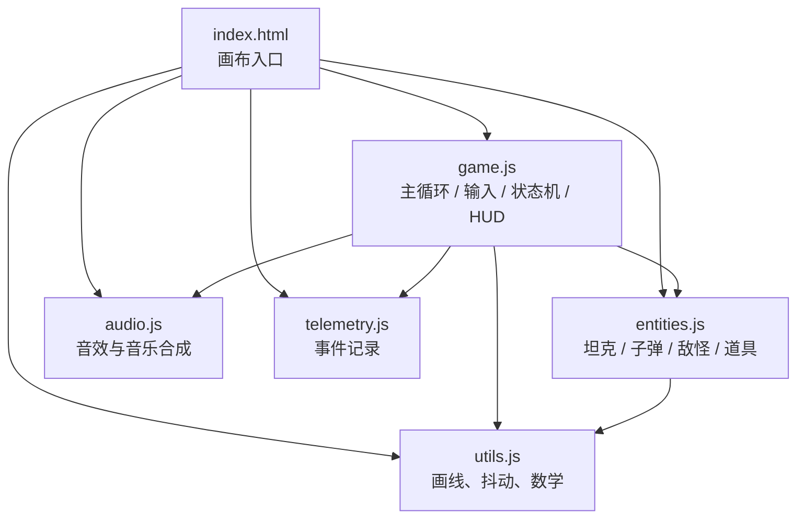

# 周一坦克 · Tank Battle

一个打工人熬过两分钟工作时间的解压小游戏。纯前端、零依赖、浏览器直接打开就能玩。

1024 Hackathon 2026 · 非研发赛道 · 单人作品

## 怎么运行

```bash
# 直接打开
open index.html

# 或起静态服务（推荐，避免部分浏览器的 file:// 限制）
python3 -m http.server 8080
```

线上：<https://welt5350.github.io/tank-battle-1024/>

## 操作

| 按键      | 动作                   |
| --------- | ---------------------- |
| `A` / `D` | 左右移动               |
| `M`       | 静音 / 取消静音        |
| `空格`    | 跳跃                   |
| `鼠标`    | 瞄准，炮管跟随指针     |
| `左键`    | 开炮，点得越快射得越快 |
| `ESC`     | 暂停                   |

**空中再按空格不能二段跳；落地才会恢复。**

## 玩法

### 一局的节奏

**共 120 秒，分三个阶段：**

| 阶段 | 时间      | 刷怪间隔 | 场上变化                       |
| ---- | --------- | -------- | ------------------------------ |
| 热身 | 0—40 秒   | 1.9 秒   | 只有未读和周会通知             |
| 加压 | 40—80 秒  | 逐渐缩短 | 屏幕提示「需求开始堆上来了」   |
| 冲刺 | 80—120 秒 | 0.8 秒   | 标题旁标「冲刺」，生存压力拉满 |

锅不参与这套节奏，固定每 15 秒来一个。

### 连击与分数

**2 秒内连续击杀才算连上**，倍率随连击数上升：

| 连击 | 1—2 | 3—4 | 5—6 | 7—8 | 9 以上 |
| ---- | --- | --- | --- | --- | ------ |
| 倍率 | ×1  | ×2  | ×3  | ×4  | ×5     |

每杀一个得 `10 × 倍率` 分。连击显示在坦克上方，掉血就断。

**结算评价**：

- **S**：熬到下班且分数 ≥ 1400
- **A**：熬到下班且分数 ≥ 900
- **B**：分数 ≥ 500
- **C**：其余

### 精神状态

血量上限 **10 点**，左上角一条连续血条，不显示数字。

- 7—10 点：灰绿
- 4—6 点：土黄
- 1—3 点：暗红

**掉血时血条会有反馈**：整条抖一下、盖一层白闪、损失的那一段单独标成暗红，旁边飘出一个「-N」。

**掉血也会连带屏幕抖动**，四档：满血完全不抖，9—7 小抖、6—4 中抖、3—1 大抖。抖动只跟血量有关，开炮和击杀在满血时不产生任何震动。

屏幕抖动在起飞无敌期间降到 35%，否则瞄不准。

### 三类职场怪

| 名字         | 出现位置                   | 行为                                                 | 代价        |
| ------------ | -------------------------- | ---------------------------------------------------- | ----------- |
| **未读**     | 地面                       | 直冲玩家，撞上即自爆                                 | 扣 1 点     |
| **周会通知** | 空中盘旋                   | 定期发射**追踪弹**，会拐弯追人                       | 扣 1 点     |
| **隔壁的锅** | 固定每 15 秒从屏幕一侧飞入 | 落地连弹三次（约 50 / 29 / 16 像素）后静置，踩到会碎 | 碰到扣 2 点 |

**追踪弹**每帧最多转向 0.052 弧度，可以靠急跳甩开，站着不动必中。

**子弹可以互相对撞抵消**：玩家子弹与敌方子弹相碰，双方一起消失。所以打追踪弹是一个可行操作。

### 隐藏机制一：画饼升天

**血量 ≤ 3 时，双击空格**：

- 10 秒无敌，不掉血
- 炮管高速自转，**自动连射**（每秒 15 发），子弹呈放射状甩出去
- 玩家只管 `WASD` 全向飞行，**撞击造成 3 点伤害**（有 18 帧冷却，贴着撞也要撞好几下）
- 结束后**随机回复 1—3 点血量**

### 隐藏机制二：夺命连环 call

**地面有 3 只"未读"挤在一起**（彼此距离不超过 50 像素），它们会合体成一只大怪：

- 血量 **10**，攻击 **3**，移动缓慢但会一直贴上来
- 撞到玩家不死，会反弹一下继续追
- 外观是一只老式电话听筒，两侧有来电振铃的声波

**打死它必掉「一天年假」。**

### 隐藏机制三：时间停止

捡起年假后，**全世界静止 5 秒**：

- 倒计时冻结
- 所有怪物、敌方子弹全部不动
- **你可以自由移动、开炮、杀怪**
- **撞到冻结的敌人也会直接把它撞碎**
- 画面压一层冷蓝 + 扫描线

## 架构

纯前端，原生 JavaScript（经典脚本，无构建步骤），图形全部 Canvas 绘制，无外部素材。

[](https://github.com/WELT5350/tank-battle-1024/actions/workflows/ci.yml)

```
index.html        入口，960×600 画布 + 样式
js/utils.js       手绘风绘制工具（抖动线、潦草矩形、手写体）、数学工具
js/entities.js    实体：PlayerTank / Bullet / Enemy 及其子类 / Item
js/audio.js       音效：用 WebAudio 现场合成，不加载任何音频文件
js/telemetry.js   埋点：记录一局内的击杀/受伤/合体等事件，结束后可导出
js/game.js        主循环、输入、状态机、刷怪、HUD、界面切换
```

### 依赖方向



箭头只朝一个方向：`game.js` 认识所有模块，`entities.js` 只认识 `utils.js`，`utils.js` 谁都不认识。

### 模块职责

| 模块           | 只管什么                                 |
| -------------- | ---------------------------------------- |
| `utils.js`     | 画线和数学，不知道任何游戏规则           |
| `audio.js`     | 只负责发声，不认识游戏对象               |
| `telemetry.js` | 只负责记录事件，不参与玩法判定           |
| `entities.js`  | 单个实体的状态与行为，不知道关卡和界面   |
| `game.js`      | 编排：读输入、更新世界、判定碰撞、画界面 |

### 状态机

```
ready ──空格──> playing ──ESC──> paused
                   │  ↑            │
                   │  └────ESC─────┘
                   ├──倒计时归零──> win
                   └──血量归零──> over
```

`paused` 状态下 `update()` 直接返回，整个世界的帧计数冻结。

### 时间停止的实现

`state.timeStop` 倒数帧数。大于 0 时：

- 跳过倒计时递减和刷怪
- 跳过所有敌人 `update()`
- 跳过敌方子弹更新
- **玩家和玩家子弹照常更新**

## 数值在哪调

集中在文件顶部的常量里：

| 常量                  | 位置        | 含义                         |
| --------------------- | ----------- | ---------------------------- |
| `MAX_HP`              | entities.js | 血量上限                     |
| `FLY_FRAMES`          | entities.js | 画饼升天时长                 |
| `JUMP_VELOCITY`       | entities.js | 跳跃初速                     |
| `BULLET_SPEED`        | entities.js | 子弹速度                     |
| `ROUND_SECONDS`       | game.js     | 一局时长                     |
| `TIME_STOP_FRAMES`    | game.js     | 时间停止时长                 |
| `MERGE_COUNT`         | game.js     | 合体需要几只未读             |
| `MERGE_RADIUS`        | game.js     | 合体要求这几只彼此的最大距离 |
| `POT_BOUNCE_SPEEDS`   | entities.js | 锅每次弹起的初速             |
| `POT_INTERVAL_FRAMES` | game.js     | 锅的出场间隔                 |
| `POT_DAMAGE`          | entities.js | 锅碰到扣的血                 |
| `FLY_RAM_DAMAGE`      | game.js     | 飞行撞击伤害                 |
| `RAM_COOLDOWN_FRAMES` | game.js     | 飞行撞击冷却                 |

## 测试

没有第三方依赖，用 Node 自带能力跑。

```bash
npm run check     # 语法 + 两套自测
npm run test      # 只跑逻辑自测
npm test          # 同上
```

两套测试，都不碰真实浏览器：

| 文件                 | 覆盖                                                                                                                              | 项数 |
| -------------------- | --------------------------------------------------------------------------------------------------------------------------------- | ---- |
| `tests/run.js`       | 纯函数与实体：数学、碰撞、血量、跳高、追踪弹转向、锅的弹跳与静置                                                                  | 40   |
| `tests/game-loop.js` | 主循环：合体触发、时停撞击、时停冻结倒计时、暂停、锅的出场节奏、击杀反馈、电话铃声开关、音频接口健壮性、埋点记录、连续 600 帧不崩 | 33   |

`game-loop.js` 用 Proxy 造了 Canvas 和 DOM 的桩，把 `game.js` 也跑起来，然后手动推进帧。

另外还会检查：`index.html` 引用的脚本都存在、没有遗留 `console.log` / `debugger`、关键常量仍然定义着。

CI 在每次 push 到 `main` 和每个 PR 上自动跑这套检查（`.github/workflows/ci.yml`）。

## 音效

全部用 WebAudio 现场合成，**没有任何音频文件**。

音效：开炮、命中、击杀、受伤、捡道具、起飞、时停、合体、**电话丁零零**、**死亡爆炸**、通关。

电话铃只在那只「夺命连环 call」活着的时候响，每 1.5 秒一次；它一被打死就停。

**背景音乐**：一段 8 秒的循环（Am–F–C–G，92 BPM），低音加弱起琶音，走单独的音乐总线，音量压得比音效低。开局自动播放，暂停、阵亡、通关时停下。

**时停时音乐整体拖慢到 42% 并降调**，玩家不看画面也能听出「世界停了」。

按 `M` 一键静音 / 取消静音。

## 调难度用的埋点

按 `F1` 打开调试面板，实时显示血量、敌人数、锅的倒计时和最近 6 条事件。

一局结束（阵亡或熬到下班）时，控制台会打印本局汇总，同时数据挂在 `window.__lastRound` 上：

```js
JSON.stringify(window.__lastRound);
```

记录的事件类型：`round_start` / `spawn` / `pot_spawn` / `kill`（带 `kind` 和 `by`）/ `damage` / `pickup` / `merge` / `flight` / `death` / `win`。

**不联网、不上传**，只在内存里。

## 开发规范

- 每次变更通过 Pull Request 提交
- `v0` tag 标记在空骨架基线（`ad2f411`），之后所有代码均为本项目新增
- 提交信息统一 `type: 描述`

## 工程脚本

```bash
npm run lint         # ESLint：错误级规则
npm run format       # Prettier 格式化
npm run format:check # 只检查格式
npm run check        # lint + 语法 + 两套自测
```

CI 会跑 `lint` + `format:check` + 语法 + 两套自测。

## 许可证

MIT，见 [LICENSE](LICENSE)。更新记录见 [CHANGELOG.md](CHANGELOG.md)。

## 已知限制

- 无自动化测试，改动靠浏览器手工回归
- 经典脚本共享全局作用域，没有模块隔离
- 移动端未适配（需要鼠标瞄准）
